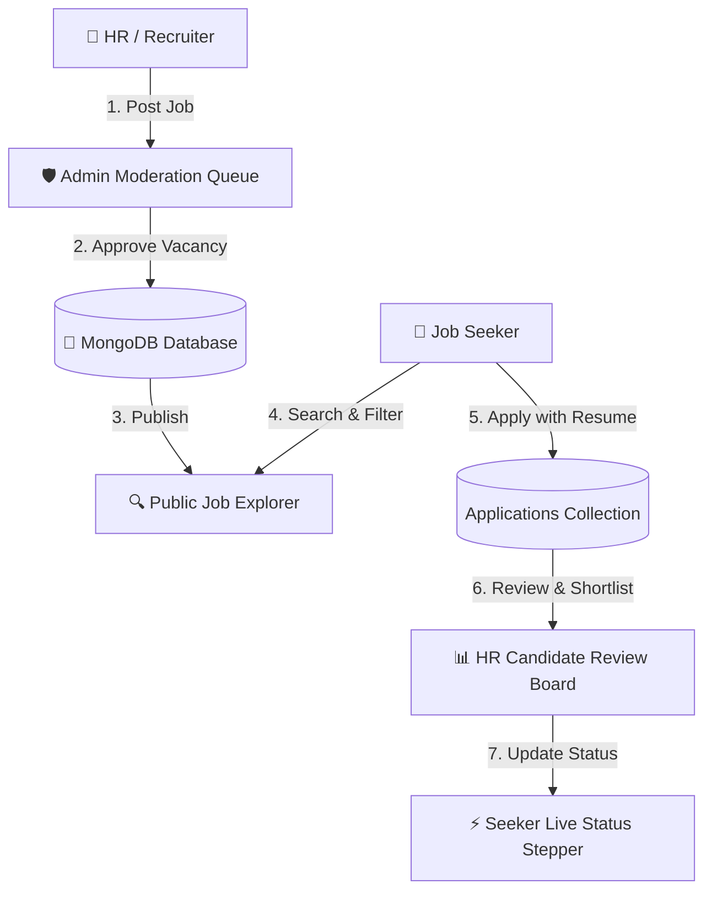
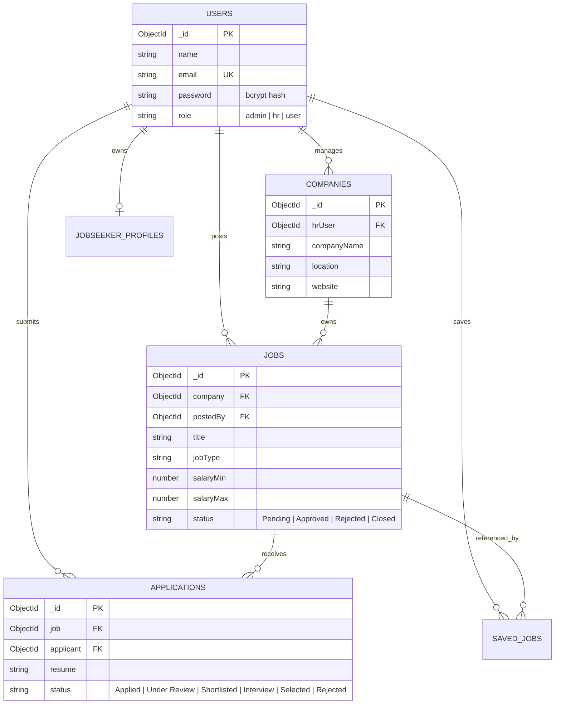

# 🌟 JobConnect – Enterprise Recruitment & Job Search Operating System

<div align="center">


<p align="center">
  <strong>A premium, high-performance recruitment ecosystem bridging verified Job Seekers, Enterprise HR Recruiters, and Platform Super Admins on a unified platform.</strong>
</p>

[✨ Launch Interactive Web App](./index.html) • [🔐 Sign In & Auth Portal](./login.html) • [📖 Architecture Spec](#-system-architecture) • [📡 API Reference](#-rest-api-documentation) • [🚀 Quick Start](#-quick-start--setup-guide)

---

</div>

## 📌 Executive Summary

Modern recruitment workflows suffer from fragmented job boards, delayed resume screenings, and opaque application pipelines. **JobConnect** solves this through a unified, 3-sided ecosystem:

1. **Job Seekers (Candidates)**: Experience friction-free job discovery with multi-criteria filtering, 1-click profile applications, live 5-stage status progress tracking, and digital resume management.
2. **HR & Recruiters**: Post detailed job openings, review candidate credentials, access verified resumes, and manage applicants dynamically across a live candidate pipeline.
3. **Super Administrators**: Oversee ecosystem health, moderate and verify job openings before public release, manage user directories, and inspect platform analytics.

---

## 🚀 Live Interactive Prototype

A standalone, zero-dependency, ultra-premium single-page application is included in this repository:

👉 **[`index.html`](./index.html)** — *Main Recruitment OS Portal*  
👉 **[`login.html`](./login.html)** — *Role-Based Sign In & Registration Gateway*

### Key Highlights of the Interactive Website:
- **Instant Role Switcher**: Switch seamlessly between **Candidate**, **HR Recruiter**, and **Super Admin** with one click in the top status bar.
- **Real-Time Job Explorer**: Search by keyword (title, company, skills), location (`Ranchi`, `Bengaluru`, `Hyderabad`, `Remote`), job type (`Full Time`, `Internship`, `Contract`), and salary range sliders.
- **Application Stepper Tracker**: Visual 5-stage progress indicator:
  $$\text{Applied} \longrightarrow \text{Under Review} \longrightarrow \text{Shortlisted} \longrightarrow \text{Interview} \longrightarrow \text{Selected}$$
- **HR Pipeline Hub**: Review applicant cover notes, trigger instant status promotions, and inspect verified candidate resumes.
- **Super Admin Queue**: Moderate pending job submissions with instant Approve/Reject actions that reflect live across the entire ecosystem.
- **Persistent LocalStorage State**: Actions taken in one role (e.g. HR posting a job or Admin approving it) immediately update the view for other roles!

---

## 🏛️ System Architecture

### High-Level Interaction Flow



---

## 👥 Core Role Capabilities

| Feature Capability | 👤 Candidate | 💼 HR Recruiter | 🛡️ Super Admin |
| :--- | :---: | :---: | :---: |
| JWT Authentication & Role Guard | ✅ | ✅ | ✅ |
| Public Job Search & Multi-Filters | ✅ | 👁️ View Only | 👁️ View Only |
| 1-Click Profile & Resume Application | ✅ | ❌ | ❌ |
| Real-Time Application Stage Stepper | ✅ | ❌ | ❌ |
| Save & Bookmark Vacancies | ✅ | ❌ | ❌ |
| Profile & Skills Tag Builder | ✅ | ❌ | ❌ |
| Company Profile Setup | ❌ | ✅ | 👁️ Audit |
| Create, Edit & Close Job Openings | ❌ | ✅ | ❌ |
| Candidate Pipeline Status Management | ❌ | ✅ | ❌ |
| Job Moderation & Approval Gate | ❌ | ❌ | ✅ |
| User & Recruiter Access Control | ❌ | ❌ | ✅ |
| System Health & Analytics KPIs | ❌ | 📊 HR Metrics | 📊 Global KPIs |

---

## 🗄️ Database Design (MongoDB & Mongoose)

JobConnect implements a relational document structure with cross-collection ObjectId references.



---

## 📡 REST API Documentation

### 1. Authentication Endpoints

| Method | Endpoint | Description | Access |
| :--- | :--- | :--- | :--- |
| `POST` | `/api/auth/register` | Register new User or HR | Public |
| `POST` | `/api/auth/login` | Authenticate & retrieve JWT Token | Public |
| `GET` | `/api/auth/me` | Fetch active user credentials | Bearer Token |

### 2. Jobs Endpoints

| Method | Endpoint | Description | Access |
| :--- | :--- | :--- | :--- |
| `GET` | `/api/jobs` | Retrieve approved jobs (supports search, filter, pagination) | Public |
| `GET` | `/api/jobs/:id` | Fetch specific job details | Public |
| `POST` | `/api/jobs` | Post new vacancy (defaults to `Pending` status) | HR Only |
| `PUT` | `/api/jobs/:id` | Modify job details | HR (Owner) |
| `DELETE` | `/api/jobs/:id` | Soft delete / close vacancy | HR (Owner) |

### 3. Application Endpoints

| Method | Endpoint | Description | Access |
| :--- | :--- | :--- | :--- |
| `POST` | `/api/applications` | Submit application with resume & cover letter | User Only |
| `GET` | `/api/applications/my` | View all applications submitted by candidate | User Only |
| `GET` | `/api/applications/job/:jobId` | View applicants for a specific opening | HR Only |
| `PUT` | `/api/applications/:id/status` | Update pipeline stage (`Shortlisted`, `Interview`, etc.) | HR Only |

### 4. Admin Endpoints

| Method | Endpoint | Description | Access |
| :--- | :--- | :--- | :--- |
| `GET` | `/api/admin/metrics` | Retrieve platform-wide KPIs | Admin Only |
| `GET` | `/api/admin/jobs/pending` | Fetch unverified job openings | Admin Only |
| `PUT` | `/api/admin/jobs/:id/approve` | Approve job opening for public listing | Admin Only |
| `PUT` | `/api/admin/jobs/:id/reject` | Reject job opening | Admin Only |
| `GET` | `/api/admin/users` | List and manage all platform accounts | Admin Only |

---

## 💻 Full-Stack Production Codebase Layout

```text
jobconnect/
│
├── index.html                   # 🚀 Standalone Interactive Web App (Instant Demo)
├── README.md                    # 📖 Premium Master Specification
│
├── frontend/                    # Modern React / Vite Client
│   ├── src/
│   │   ├── components/          # Reusable UI widgets (JobCard, FilterBar, Stepper)
│   │   ├── pages/
│   │   │   ├── Home.jsx         # Hero & Job Discovery
│   │   │   ├── JobDetails.jsx   # Detailed vacancy view & apply modal
│   │   │   ├── UserDashboard.jsx# Candidate applications & saved jobs
│   │   │   ├── HRDashboard.jsx  # Recruiter metrics & candidate pipeline
│   │   │   └── AdminDashboard.jsx# Job moderation & user directory
│   │   ├── context/AuthContext.jsx # JWT State & Role Provider
│   │   ├── services/api.js      # Axios instance with interceptors
│   │   └── App.jsx
│   └── package.json
│
└── backend/                     # Node.js + Express API Server
    ├── config/db.js             # Mongoose connection
    ├── controllers/
    │   ├── authController.js
    │   ├── jobController.js
    │   ├── applicationController.js
    │   └── adminController.js
    ├── middleware/
    │   ├── authMiddleware.js    # JWT verification
    │   └── roleMiddleware.js    # RBAC check (admin, hr, user)
    ├── models/
    │   ├── User.js
    │   ├── Company.js
    │   ├── Job.js
    │   ├── Application.js
    │   ├── JobSeekerProfile.js
    │   └── SavedJob.js
    ├── routes/
    │   ├── authRoutes.js
    │   ├── jobRoutes.js
    │   ├── applicationRoutes.js
    │   └── adminRoutes.js
    ├── server.js
    └── package.json
```

---

## 🚀 Quick Start & Setup Guide

### 1. Run the Interactive Website Immediately
- **Standalone App**: Open **[`index.html`](./index.html)** in any browser.
- **Standalone React 18 Build**: Open **[`react-preview.html`](./react-preview.html)**.
- **Auth & Login Portal**: Open **[`login.html`](./login.html)**.

### 2. Frontend React + Tailwind Setup (Vite)

```bash
# Navigate to frontend
cd frontend

# Install dependencies (React 18, Tailwind CSS, Lucide)
npm install

# Start Vite React development server
npm run dev
# -> Local server running at http://localhost:3000
```

### 3. Backend Server Setup (For Full Stack Development)

```bash
# Navigate to backend
cd backend

# Install dependencies
npm install express mongoose dotenv bcryptjs jsonwebtoken cors

# Create environment configuration (.env)
cat <<EOF > .env
PORT=5000
MONGO_URI=mongodb://127.0.0.1:27017/jobconnect
JWT_SECRET=super_secret_jwt_key_2026
EOF

# Start development server
npm run dev
```

---

## 🛡️ Security & Quality Standards

- **Password Cryptography**: Passwords salted and hashed with `bcryptjs` (cost factor 10).
- **Stateless Authorization**: Signed JSON Web Tokens (JWT) with configurable expiration (`24h`).
- **Role-Based Guards**: Strict Express route protection enforcing access controls (`admin`, `hr`, `user`).
- **Data Validation & Sanitization**: Strict schema constraints in Mongoose to prevent prototype poisoning and injection.

---

<div align="center">
  <p><strong>JobConnect © 2026. Built with modern web standards for scalable recruitment.</strong></p>
</div>
