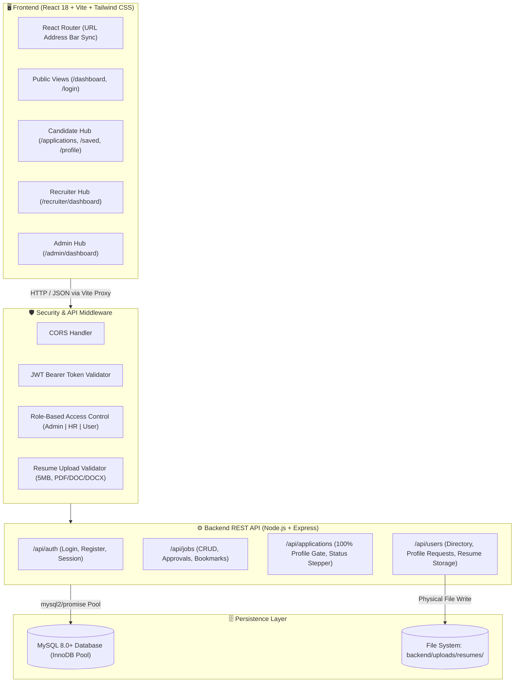
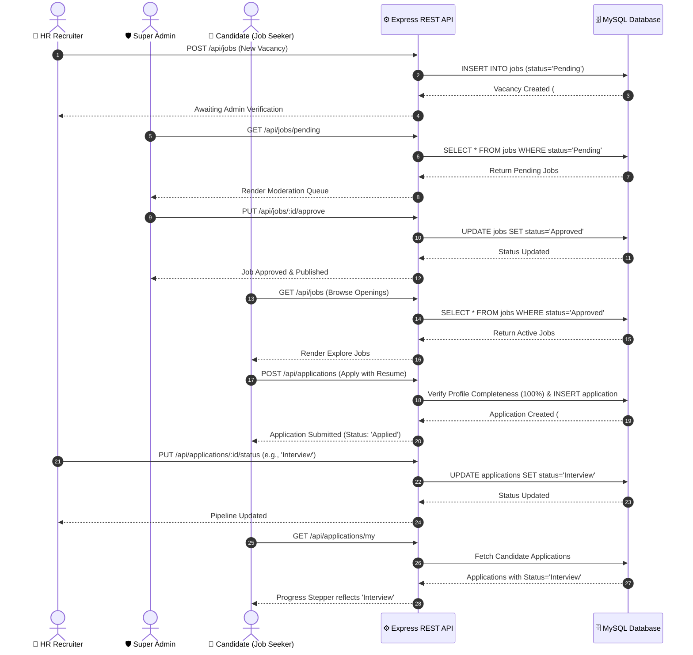
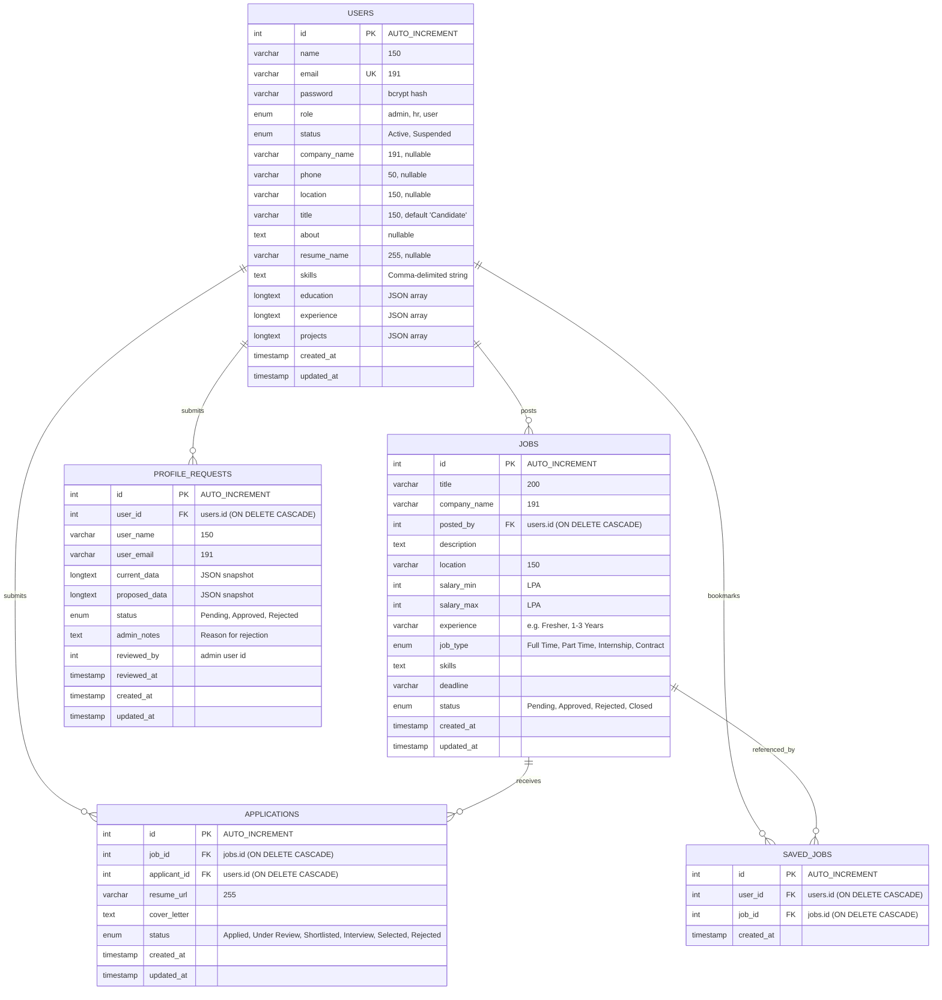
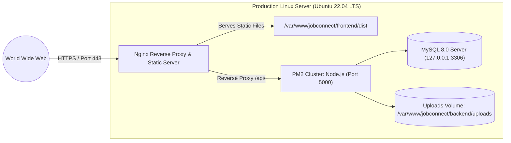

# 🌟 JobConnect – Enterprise Recruitment & Job Search Operating System

<div align="center">


<p align="center">
  <strong>A high-performance recruitment ecosystem bridging verified Job Seekers, Enterprise HR Recruiters, and Platform Super Admins on a unified full-stack architecture.</strong>
</p>

[📌 System Overview](#-system-overview) • [🏛️ System Architecture](#-system-architecture) • [👥 Role-Based Capabilities](#-role-based-capabilities) • [🗄️ Database Design (MySQL)](#-database-design-mysql) • [📡 REST API Reference](#-rest-api-reference) • [💻 Codebase Layout](#-codebase-layout) • [🚀 Local Setup](#-local-setup-guide) • [🌐 Production Deployment](#-production-deployment-guide)

---

</div>

## 📌 System Overview

**JobConnect** is an enterprise-grade recruitment platform designed to eliminate opaque hiring pipelines, slow resume screenings, and disconnected job boards. Built on a decoupled full-stack architecture—a reactive **React 18** client powered by **Vite** and **Tailwind CSS**, communicating with a **Node.js / Express** REST API backed by a relational **MySQL** database with strict relational integrity.

### 🌟 Key Platform Highlights:
- **Public & Frictionless Exploration**: Unauthenticated visitors can freely browse, search, and filter verified job vacancies without forced sign-in.
- **Intelligent Auth Gate & Context Retention**: Attempting to apply, save a vacancy, or access candidate features prompts sign-in, seamlessly redirecting the user back to complete their pending action after authentication.
- **Profile Completeness Guard**: Candidates must complete their profile to **100%** before applying to ensure employers receive complete candidate credentials.
- **5-Stage Application Tracker**: Visual real-time pipeline tracker (`Applied` ➔ `Under Review` ➔ `Shortlisted` ➔ `Interview` ➔ `Selected`, or `Rejected`).
- **HR Vacancy Lifecycle & Ownership**: Recruiters post vacancies that enter an Admin verification gate; recruiters can delete their own postings with cascading cleanup across applications and bookmarks.
- **Super Admin Governance**: Super Admins moderate pending jobs, approve or reject HR profile edit requests, inspect platform analytics, and enforce user access control (Active / Suspended).

---

## 🏛️ System Architecture

### Architectural Component Diagram



### End-to-End Recruitment Workflow



---

## 👥 Role-Based Capabilities

| Feature & Operational Capability | 👤 Candidate (`user`) | 💼 HR Recruiter (`hr`) | 🛡️ Super Admin (`admin`) | Unauthenticated Visitor |
| :--- | :---: | :---: | :---: | :---: |
| **Public Vacancy Exploration** | ✅ | ✅ | ✅ | ✅ |
| **Keyword, Location & Salary Filtering** | ✅ | ✅ | ✅ | ✅ |
| **Apply for Vacancies** | ✅ *(100% profile req.)* | ❌ | ❌ | 🔒 *(Redirects to Login)* |
| **Save / Bookmark Vacancies** | ✅ *(Saved Jobs)* | ❌ | ❌ | 🔒 *(Redirects to Login)* |
| **5-Stage Application Tracker** | ✅ | ❌ | ❌ | ❌ |
| **Resume Upload (.pdf, .doc, .docx)** | ✅ *(Max 5MB)* | ❌ | ❌ | ❌ |
| **Post New Job Vacancies** | ❌ | ✅ *(Pending Admin Gate)* | ❌ | ❌ |
| **Delete Own Vacancy Posts** | ❌ | ✅ *(Cascades Apps & Saves)* | ✅ *(Any Vacancy)* | ❌ |
| **Candidate Pipeline Management** | ❌ | ✅ *(Company Scope)* | ✅ *(Global Scope)* | ❌ |
| **HR Profile Moderation Queue** | ❌ | ❌ | ✅ *(Approve / Reject)* | ❌ |
| **Job Moderation Queue** | ❌ | ❌ | ✅ *(Approve / Reject)* | ❌ |
| **User Directory & Account Suspension** | ❌ | ❌ | ✅ *(Active/Suspended)* | ❌ |

---

## 🗄️ Database Design (MySQL)

JobConnect runs on **MySQL** with strict relational foreign key constraints, `ON DELETE CASCADE` rules, and normalized relational indexing.

### Entity-Relationship (ER) Diagram



### Relational Table Specifications

1. **`users` Table**:
   - Stores account credentials, role flags (`admin`, `hr`, `user`), profile data, and JSON-encoded educational, experience, and project portfolios.
   - Primary Key: `id` (INT Auto Increment). Unique Index: `idx_users_email` (`email`).
2. **`jobs` Table**:
   - Stores vacancies posted by HR recruiters or admins.
   - Foreign Key: `fk_jobs_posted_by` (`posted_by` ➔ `users.id` with `ON DELETE CASCADE`).
   - Default status is `Pending`, requiring admin verification before public visibility.
3. **`applications` Table**:
   - Stores job seeker applications and status progression.
   - Unique Constraint: `unique_job_applicant` (`job_id`, `applicant_id`) prevents duplicate applications.
   - Foreign Keys: `fk_apps_job` and `fk_apps_applicant` with `ON DELETE CASCADE`.
4. **`saved_jobs` Table**:
   - Manages candidate vacancy bookmarks.
   - Unique Constraint: `unique_user_saved_job` (`user_id`, `job_id`).
5. **`profile_requests` Table**:
   - Holds pending profile change requests submitted by HR recruiters for Admin review.
   - Preserves old vs. proposed state as JSON snapshots until approved or rejected with admin feedback.

---

## 🔐 Authentication, Authorization & Security

### 1. JSON Web Tokens (JWT) & bcrypt
- **Password Protection**: Passwords are encrypted with `bcryptjs` using a salt work factor of 10.
- **Stateless Authorization**: Signed tokens contain user ID and role (`{ id, role }`) with a 30-day expiration window.
- **Client Transmission**: Sent as an HTTP Authorization header (`Authorization: Bearer <token>`).

### 2. Multi-Role Segregated Login Portal
The `/login` gateway enforces strict role separation:
- Candidate accounts (`role: 'user'`) cannot sign in via the HR or Admin tabs.
- HR accounts (`role: 'hr'`) cannot sign in via the Candidate or Admin tabs.
- Admin accounts (`role: 'admin'`) can only authenticate through the Super Admin portal.
- Account creation as an Administrator via the public registration endpoint is strictly prohibited (`403 Forbidden`).

### 3. Account Suspension Enforcement
When an administrator suspends a user in the Admin Dashboard, the backend instantly rejects login requests (`403 Forbidden: Your account is currently suspended`) and revokes access to protected API endpoints.

### 4. Official Built-In Demo Credentials

The platform includes self-healing demo accounts pre-seeded into MySQL:

| Role | Demo Email | Demo Password | Purpose |
| :--- | :--- | :--- | :--- |
| **Candidate** | `ankit.dev@example.com` | `candidate123` | Pre-configured 100% profile with skills, resume, and active applications |
| **HR Recruiter** | `priya.hr@abctech.com` | `recruiter123` | Linked to "ABC Technologies" with pre-existing job vacancies |
| **Super Admin** | `admin@jobconnect.io` | `superadmin123` | Platform oversight, moderation queues, and user directory management |

---

## 🧭 Frontend Routing & Navigation Specification

The frontend implements client-side URL routing via React Router. The browser address bar reflects the active view at all times, enabling direct URL navigation, bookmarking, and page refreshes.

### Route Map

| URL Path | Access Policy | Target Component & Functionality |
| :--- | :--- | :--- |
| `/` | Public | Root Dispatcher: Redirects unauthenticated users to `/dashboard`, or redirects logged-in users to their role-specific home |
| `/dashboard` | Public / Seeker | **Explore Jobs**: Search, multi-criteria filters, and job card inspection (publicly accessible) |
| `/jobs` | Public | Alias redirecting to `/dashboard` |
| `/applications` | Protected (`user`) | **Application Status Tracker**: Displays active applications and 5-stage progress indicator |
| `/saved` | Protected (`user`) | **Saved Jobs**: Quick access to bookmarked vacancies |
| `/saved-jobs` | Protected (`user`) | Alias redirecting to `/saved` |
| `/profile` | Protected (`user`) | **Candidate Profile**: 100% completeness meter, skills tagger, resume upload |
| `/my-profile` | Protected (`user`) | Alias redirecting to `/profile` |
| `/recruiter/dashboard` | Protected (`hr`) | **HR Management Hub**: Post vacancies, candidate review pipeline, vacancy deletion |
| `/hr/dashboard` | Protected (`hr`) | Alias redirecting to `/recruiter/dashboard` |
| `/admin/dashboard` | Protected (`admin`) | **Super Admin Hub**: Job approvals, HR profile requests, user directory & suspensions |
| `/login` | Public Only | **Authentication Gateway**: Role tabs for Candidate, HR, and Admin |

### Intelligent Context-Preserving Redirection Flow
1. When an unauthenticated visitor clicks **Apply Now** on a job card:
   - The app stores the intended action (`apply`) and vacancy ID (`jobId`) in `sessionStorage`.
   - The user is redirected to `/login` with an informational toast.
2. After logging in with Candidate credentials:
   - The app retrieves the stored redirect path and pending action.
   - The candidate is returned to the vacancy with the application modal automatically opened.

---

## 📡 REST API Reference

All protected endpoints require the HTTP header:  
`Authorization: Bearer <jwt_token>`

### 1. Authentication Endpoints (`/api/auth`)

| Method | Endpoint | Access | Description | Request Body Payload |
| :--- | :--- | :--- | :--- | :--- |
| `POST` | `/api/auth/register` | Public | Register Candidate or HR | `{ name, email, password, role, company?, phone? }` |
| `POST` | `/api/auth/login` | Public | Authenticate user & get JWT | `{ email, password, role }` |
| `GET` | `/api/auth/me` | Protected | Validate token & fetch profile | *None* |

### 2. Jobs Endpoints (`/api/jobs`)

| Method | Endpoint | Access | Description | Query / Body Payload |
| :--- | :--- | :--- | :--- | :--- |
| `GET` | `/api/jobs` | Public / Auth | List vacancies (Candidates see Approved; HR sees Approved + own; Admin sees all) | `?keyword=&location=&jobType=&minSalary=&status=` |
| `GET` | `/api/jobs/pending` | Admin | Fetch unverified vacancies awaiting moderation | *None* |
| `GET` | `/api/jobs/my` | HR | Fetch vacancies posted by the logged-in recruiter | *None* |
| `GET` | `/api/jobs/saved/my` | Candidate | Fetch candidate's bookmarked job IDs from MySQL | *None* |
| `GET` | `/api/jobs/:id` | Public | Fetch vacancy details by ID | *None* |
| `POST` | `/api/jobs` | HR | Post new job (defaults to `Pending` status) | `{ title, companyName, location, jobType, salaryMin, salaryMax, experience, skills, description, deadline }` |
| `POST` | `/api/jobs/:id/save`| Candidate | Toggle bookmark on vacancy in `saved_jobs` table | *None* |
| `PUT` | `/api/jobs/:id/approve` | Admin | Approve pending vacancy and publish it live | *None* |
| `PUT` | `/api/jobs/:id/reject` | Admin | Reject pending vacancy | *None* |
| `DELETE` | `/api/jobs/:id` | HR (Owner) / Admin | Delete vacancy; cascades child applications & bookmarks | *None* |

### 3. Application Endpoints (`/api/applications`)

| Method | Endpoint | Access | Description | Request Body Payload |
| :--- | :--- | :--- | :--- | :--- |
| `POST` | `/api/applications` | Candidate | Apply for vacancy (Requires 100% profile completeness) | `{ jobId, resume, coverLetter }` |
| `GET` | `/api/applications/my` | Candidate | Fetch candidate's submitted applications with live stages | *None* |
| `GET` | `/api/applications` | HR / Admin | Fetch applicants (HR filtered by company; Admin views all) | `?jobId=&status=&company=` |
| `PUT` | `/api/applications/:id/status` | HR / Admin | Update stage (`Applied`, `Under Review`, `Shortlisted`, `Interview`, `Selected`, `Rejected`) | `{ status: "<new_status>" }` |

### 4. User, Profile & Administration Endpoints (`/api/users`)

| Method | Endpoint | Access | Description | Request Body Payload |
| :--- | :--- | :--- | :--- | :--- |
| `GET` | `/api/users` | Admin | Fetch user directory for platform audit | *None* |
| `PUT` | `/api/users/:id/status` | Admin | Toggle account status between `Active` and `Suspended` | *None* |
| `GET` | `/api/users/profile-requests` | Admin | List all pending HR profile edit requests | *None* |
| `GET` | `/api/users/profile-requests/my` | HR | Fetch status of own pending profile change request | *None* |
| `PUT` | `/api/users/profile-requests/:id/approve` | Admin | Approve HR profile change and commit updates to MySQL | *None* |
| `PUT` | `/api/users/profile-requests/:id/reject` | Admin | Reject HR profile change with feedback reason | `{ reason: "<notes>" }` |
| `GET` | `/api/users/profile/:email` | Protected | Fetch candidate profile by email | *None* |
| `PUT` | `/api/users/profile` | Protected | Candidate updates profile directly; HR updates submit moderation request | `{ name, phone, location, title, about, skills, resume_name, education, experience, projects }` |
| `POST` | `/api/users/resume` | Candidate | Upload resume document (max 5MB, `.pdf`, `.doc`, `.docx`) | `{ fileName, fileData, fileSize }` |

---

## 💻 Codebase Layout

```text
jobconnect/
├── jobconnect_schema.sql         # 🗄️ Master MySQL schema, indices, constraints & seed data
├── README.md                     # 📖 Official Project Specification & Documentation
│
├── frontend/                     # 🖥️ Client Web Application (React 18 + Vite)
│   ├── index.html                # Vite HTML entry point
│   ├── vite.config.js            # Vite configuration with API reverse proxy
│   ├── tailwind.config.js        # Tailwind CSS design tokens
│   ├── package.json              # Client dependencies (React 18, Lucide, Tailwind)
│   └── src/
│       ├── main.jsx              # React DOM initialization
│       ├── App.jsx               # Route definitions, guards & URL dispatching
│       ├── router/               # React Router wrappers & hooks
│       ├── context/
│       │   └── AuthContext.jsx   # Global auth state, session check & API operations
│       ├── pages/
│       │   ├── Home.jsx          # Dynamic hub hosting Seeker, HR & Admin views
│       │   └── Login.jsx         # Role-separated authentication gateway
│       ├── components/
│       │   ├── common/           # Navbar, Footer, ToastContainer, ErrorBoundary
│       │   ├── seeker/           # SeekerDashboard, JobCard, StatusTracker, ProfileTab
│       │   ├── hr/               # HrDashboard, PostingsList, PipelineTable
│       │   ├── admin/            # AdminDashboard, JobModerationQueue, Directory
│       │   └── modals/           # PostJobModal, JobDetailModal, EditProfileModal, etc.
│       └── utils/                # Profile completeness calculator, job ID parsers
│
└── backend/                      # ⚙️ REST API Server (Node.js + Express + MySQL)
    ├── server.js                 # Express server configuration & route mounting
    ├── package.json              # Backend dependencies (express, mysql2, bcryptjs, jwt)
    ├── .env                      # Environment configuration (Port, DB credentials, JWT)
    ├── config/
    │   └── db.js                 # mysql2/promise pool & automatic schema seeding
    ├── middleware/
    │   ├── authMiddleware.js     # JWT Bearer token verification
    │   └── roleMiddleware.js     # Role verification guards (admin, hr, user)
    ├── models/
    │   ├── User.js               # User & Profile MySQL query wrapper
    │   ├── Job.js                # Vacancy MySQL query wrapper
    │   ├── Application.js        # Application & Pipeline MySQL query wrapper
    │   └── ProfileRequest.js     # HR Profile moderation MySQL query wrapper
    ├── routes/
    │   ├── authRoutes.js         # Authentication & registration endpoints
    │   ├── jobRoutes.js          # Job vacancy CRUD & bookmark endpoints
    │   ├── applicationRoutes.js  # Application submission & status endpoints
    │   └── userRoutes.js         # Directory, profile & resume upload endpoints
    └── uploads/
        └── resumes/              # Stored candidate resume files (.pdf, .doc, .docx)
```

---

## 🚀 Local Setup Guide

### 1. Prerequisites
Ensure the following are installed on your machine:
- **Node.js**: Version 18.x or 20.x+
- **MySQL Server**: Version 8.0+ or MariaDB 10.5+ (e.g., via MySQL Community Server or XAMPP)
- **npm**: Version 9+

---

### 2. Database Setup

1. Start your local MySQL server (port `3306`).
2. Log in to MySQL and initialize the database (optional if relying on automatic startup seeding):
   ```sql
   CREATE DATABASE IF NOT EXISTS `jobconnect_db` 
     DEFAULT CHARACTER SET utf8mb4 
     DEFAULT COLLATE utf8mb4_unicode_ci;
   ```
3. To manually run the full schema with pre-populated demo data:
   ```bash
   mysql -u root -p jobconnect_db < jobconnect_schema.sql
   ```
   *(Note: The backend automatically verifies tables and seeds demo accounts on first launch if not already present).*

---

### 3. Backend API Setup

1. Open a terminal and navigate to `backend/`:
   ```bash
   cd backend
   ```
2. Install Node dependencies:
   ```bash
   npm install
   ```
3. Create or verify the environment configuration file (`backend/.env`):
   ```env
   PORT=5000
   DB_HOST=localhost
   DB_USER=root
   DB_PASSWORD=your_mysql_password
   DB_PORT=3306
   DB_NAME=jobconnect_db
   JWT_SECRET=super_secret_jwt_key_jobconnect_2026
   ```
4. Start the backend server:
   ```bash
   # Development mode with nodemon auto-reload:
   npm run dev

   # Standard production start:
   npm start
   ```
   Verify the API is healthy by visiting `http://localhost:5000/`. You should receive:
   ```json
   {
     "status": "online",
     "project": "JobConnect REST API",
     "engine": "MySQL (mysql2)",
     "database": "jobconnect_db",
     "version": "2.0.0"
   }
   ```

---

### 4. Frontend Client Setup

1. Open a second terminal and navigate to `frontend/`:
   ```bash
   cd frontend
   ```
2. Install dependencies:
   ```bash
   npm install
   ```
3. Launch the Vite development server:
   ```bash
   npm run dev
   ```
4. Open your browser and navigate to:
   ```
   http://localhost:3000
   ```
   The Vite dev server proxies API calls (`/api/*`) directly to the backend on `http://localhost:5000`.

---

## 🌐 Production Deployment Guide

### Deployment Architecture Overview



---

### 1. Database Provisioning in Production
Create a dedicated MySQL production user with scoped privileges:
```sql
CREATE DATABASE `jobconnect_db` DEFAULT CHARACTER SET utf8mb4 COLLATE utf8mb4_unicode_ci;

CREATE USER 'jobconnect_user'@'localhost' IDENTIFIED BY 'Strong_Production_Password_#2026';
GRANT ALL PRIVILEGES ON `jobconnect_db`.* TO 'jobconnect_user'@'localhost';
FLUSH PRIVILEGES;
```

---

### 2. Backend Production Deployment (PM2)

1. On the server, navigate to the backend directory and install production dependencies:
   ```bash
   cd /var/www/jobconnect/backend
   npm ci --omit=dev
   ```
2. Configure production `.env`:
   ```env
   NODE_ENV=production
   PORT=5000
   DB_HOST=127.0.0.1
   DB_USER=jobconnect_user
   DB_PASSWORD=Strong_Production_Password_#2026
   DB_PORT=3306
   DB_NAME=jobconnect_db
   JWT_SECRET=production_random_entropy_secret_64_bytes
   ```
3. Create the persistent upload folder:
   ```bash
   mkdir -p uploads/resumes
   chmod -R 755 uploads
   ```
4. Start and manage the backend process using **PM2**:
   ```bash
   npm install -g pm2
   pm2 start server.js --name "jobconnect-api" -i max
   pm2 save
   pm2 startup
   ```

---

### 3. Frontend Production Build

1. Navigate to `frontend/`:
   ```bash
   cd /var/www/jobconnect/frontend
   npm ci
   ```
2. Build the optimized static assets:
   ```bash
   npm run build
   ```
   This generates the production bundle in `frontend/dist/`.

---

### 4. Nginx Reverse Proxy & SSL Configuration

Create an Nginx configuration file at `/etc/nginx/sites-available/jobconnect`:

```nginx
server {
    listen 80;
    server_name jobs.yourdomain.com;
    return 301 https://$host$request_uri;
}

server {
    listen 443 ssl http2;
    server_name jobs.yourdomain.com;

    # SSL Certificates (managed via Certbot / Let's Encrypt)
    ssl_certificate /etc/letsencrypt/live/jobs.yourdomain.com/fullchain.pem;
    ssl_certificate_key /etc/letsencrypt/live/jobs.yourdomain.com/privkey.pem;
    ssl_protocols TLSv1.2 TLSv1.3;
    ssl_ciphers HIGH:!aNULL:!MD5;

    # Frontend Static Files
    root /var/www/jobconnect/frontend/dist;
    index index.html;

    # Gzip Compression
    gzip on;
    gzip_types text/plain text/css application/json application/javascript text/xml application/xml application/xml+rss text/javascript;

    # Max File Upload Size for Resumes (10MB)
    client_max_body_size 10M;

    # Handle React Router Client-Side Navigation
    location / {
        try_files $uri $uri/ /index.html;
    }

    # Proxy API Requests to Node.js Backend
    location /api/ {
        proxy_pass http://127.0.0.1:5000/api/;
        proxy_http_version 1.1;
        proxy_set_header Upgrade $http_upgrade;
        proxy_set_header Connection 'upgrade';
        proxy_set_header Host $host;
        proxy_set_header X-Real-IP $remote_addr;
        proxy_set_header X-Forwarded-For $proxy_add_x_forwarded_for;
        proxy_set_header X-Forwarded-Proto $scheme;
        proxy_cache_bypass $http_upgrade;
    }

    # Static Resume Attachments (Optional direct access if desired)
    location /uploads/ {
        alias /var/www/jobconnect/backend/uploads/;
        expires 30d;
        add_header Cache-Control "public, no-transform";
    }
}
```

Enable the configuration and reload Nginx:
```bash
sudo ln -s /etc/nginx/sites-available/jobconnect /etc/nginx/sites-enabled/
sudo nginx -t
sudo systemctl reload nginx
```

---

## 🛡️ Operational Maintenance & Health Monitoring

- **Database Health**: Verify connection pool status via the `GET /` API root endpoint.
- **Process Monitoring**: Inspect backend performance and restarts via `pm2 status` and `pm2 logs jobconnect-api`.
- **Database Backups**: Schedule daily MySQL dumps:
  ```bash
  mysqldump -u jobconnect_user -p jobconnect_db | gzip > /var/backups/jobconnect_$(date +\%F).sql.gz
  ```

---

<div align="center">
  <p><strong>JobConnect © 2026. Built with modern web standards, relational data integrity, and enterprise security.</strong></p>
</div>